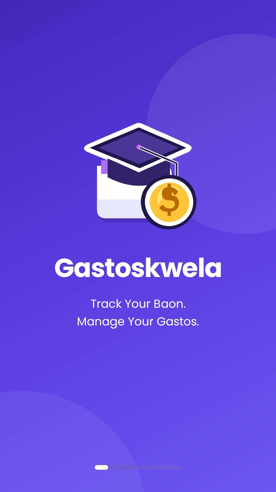
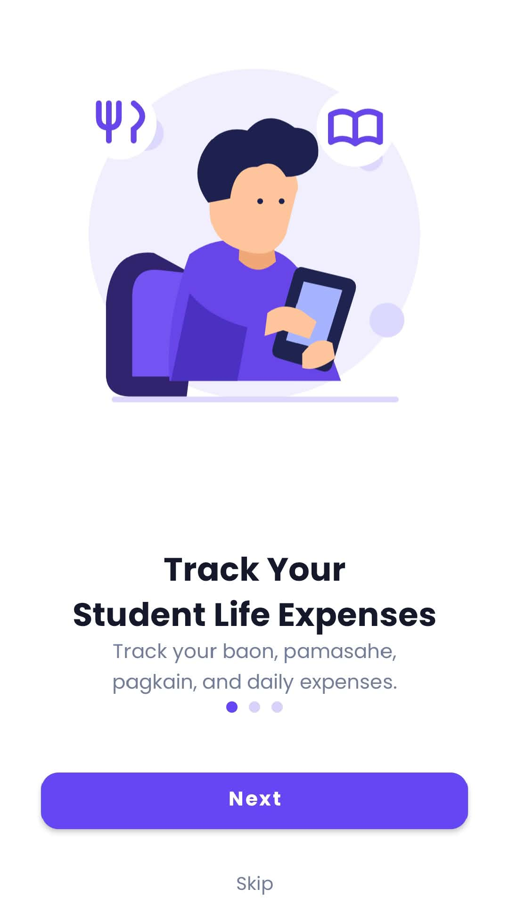
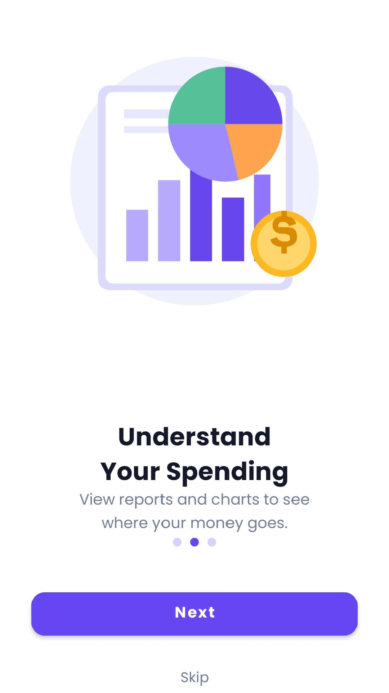
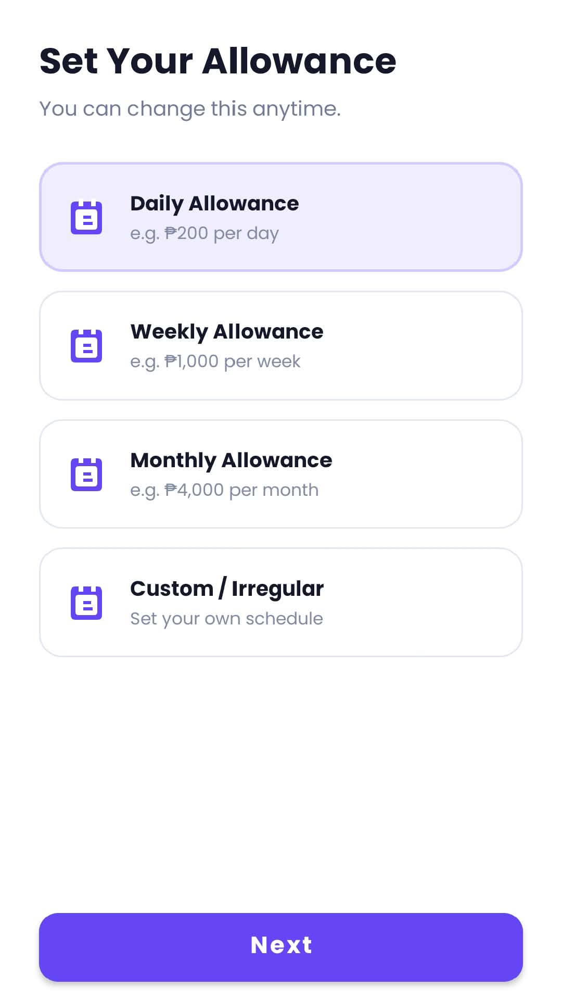
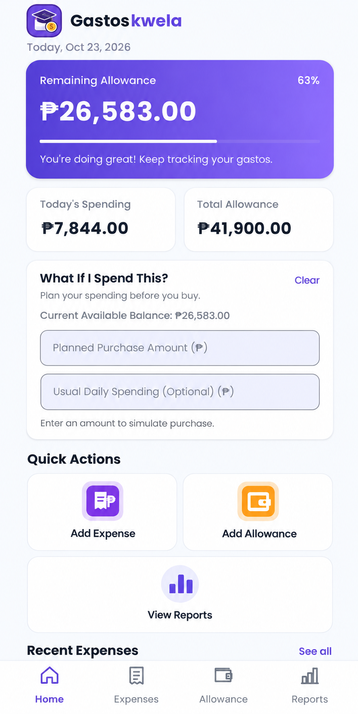
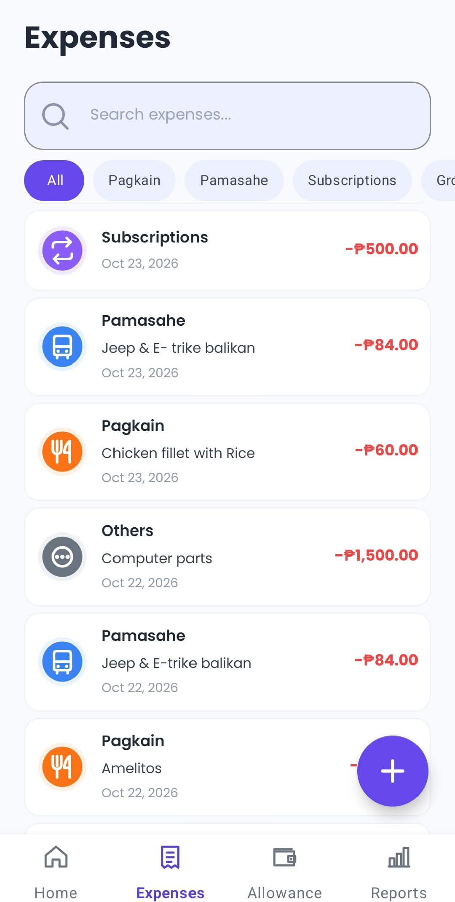
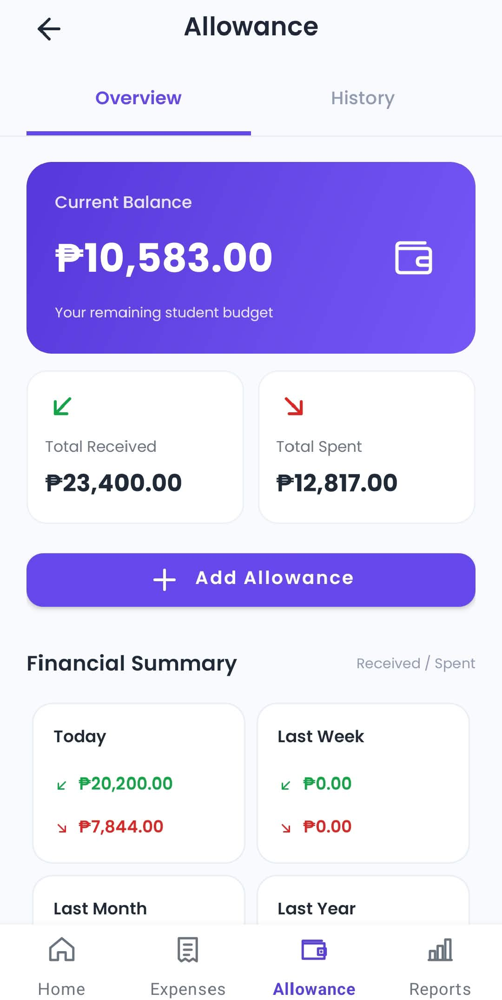
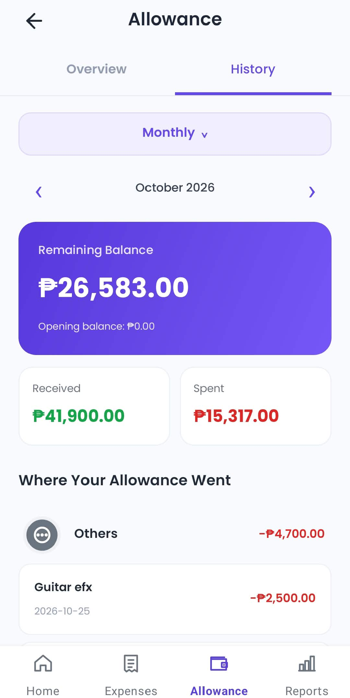
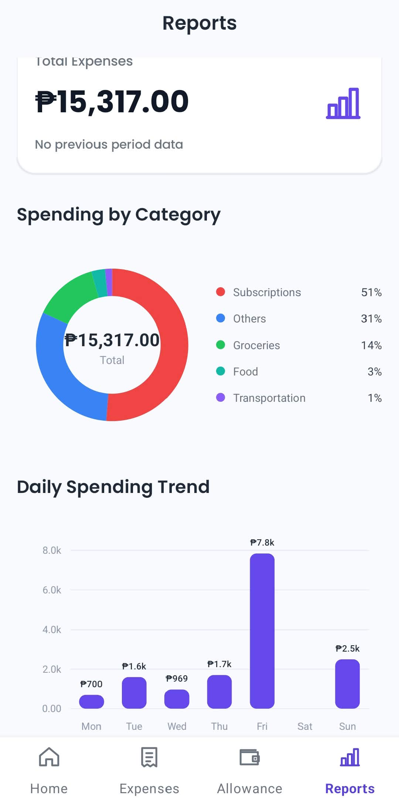

# 🎓 Gastoskwela

**Gastoskwela** is a native Android application designed to help students manage their daily allowance, track expenses, and monitor their spending habits in one place. Built with **Kotlin and XML layouts**, it provides a simple way to manage personal finances and develop better budgeting habits.

## 📖 About the Project

Gastoskwela is a student-focused financial tracker developed as a **Mobile Application Development** project. It works offline and stores financial records locally using a **Room database**.

The app includes four main sections:

- 🏠 **Home** — View remaining allowance, spending summaries, budget progress, and recent expenses.
- 💸 **Expenses** — Add, edit, delete, search, and filter daily expenses by category.
- 💰 **Allowance** — Record and manage allowance entries and view the total allowance.
- 📊 **Reports** — Review financial summaries and charts to understand spending habits.

## ✨ Key Features

- **Allowance tracking** — Record and manage allowance entries.
- **Expense management** — Add, edit, delete, search, and categorize personal expenses.
- **Financial dashboard** — View total allowance, total expenses, remaining balance, and budget progress.
- **Spending reports** — Visualize financial summaries and expense trends through charts.
- **Philippine peso formatting** — Display amounts in Philippine pesos (₱).
- **Local data storage** — Use core features offline with Room database.
- **Student-friendly interface** — Simple navigation with custom icons and XML layouts.

## 🛠️ Built With

| Technology | Purpose |
|---|---|
| Kotlin | Application logic |
| XML | Android user interface |
| Android Studio | Development environment |
| Room Database | Local data persistence |
| Coroutines & Flow | Reactive database updates |
| Material Components | UI components |

## 📸 App Screenshots

Screenshots of **Gastoskwela v1.1.0**, including onboarding, allowance management, expense tracking, and financial reports.

### Final UI Overview

The following overview presents 10 application screens in a single visual collage.


### Individual App Screenshots

#### Splash Screen & Onboarding

| Splash Screen | Expense Tracking |
|:---:|:---:|
|  |  |

| Spending Reports | Financial Goals |
|:---:|:---:|
|  |  |

#### Allowance Setup & Home Dashboard

| Allowance Setup | Home Dashboard |
|:---:|:---:|
|  |  |

#### Expense & Allowance Management

| Expenses | Allowance Overview |
|:---:|:---:|
|  |  |

#### Financial History & Reports

| Allowance History | Financial Reports |
|:---:|:---:|
|  |  |

## 📱 Installation

1. Download the APK from the [latest GitHub release](https://github.com/clarxxinn/Gastoskwela/releases/latest).
2. Transfer the APK to an Android device if necessary.
3. Open the APK and allow installation from that source if prompted.
4. Install and launch **Gastoskwela**.

### Build from Source

Clone the repository and check out the final release:

```bash
git clone https://github.com/clarxxinn/Gastoskwela.git
cd Gastoskwela
git checkout v1.1.0
```

Open the project in Android Studio, or build a debug APK:

```bash
./gradlew :app:assembleDebug
```

On Windows PowerShell:

```powershell
.\gradlew.bat :app:assembleDebug
```

The generated APK is located at `app/build/outputs/apk/debug/app-debug.apk`.

## 📂 Project Structure

```text
Gastoskwela/
├── app/                 # Android application source code
├── documentation/       # Project documentation
├── screenshots/         # Application screenshots
├── gradle/              # Gradle wrapper files
├── README.md
├── build.gradle.kts
└── settings.gradle.kts
```

## 👨‍💻 Project Team Members

Gastoskwela is a group final project for Mobile Application Development.

| Team Member | GitHub Account |
|---|---|
| Rainier James Rodiel | [@clarxxinn](https://github.com/clarxxinn) |
| Raeven Perez | [@raemprz](https://github.com/raemprz) |
| John Erick Eugenio | — |
| Catherine Talucud | — |
| Maxwell Alfaro | — |

### GitHub Contributors

The following team members have recorded contributions in the repository's Git history:

- [Rainier James Rodiel (@clarxxinn)](https://github.com/clarxxinn)
- [Raeven Perez (@raemprz)](https://github.com/raemprz)

## 🏷️ Version Information

- **Version:** 1.1.0
- **Platform:** Android
- **Project Complexity:** Intermediate
- **Release:** [Gastoskwela v1.1.0 — Final Release](https://github.com/clarxxinn/Gastoskwela/releases/tag/v1.1.0)

## 🎯 Project Purpose

Gastoskwela aims to help students develop better financial management and budgeting habits by organizing their allowance and daily expenses in a single offline Android application.

---

**Gastoskwela** — *Track your gastos, manage your allowance.*
